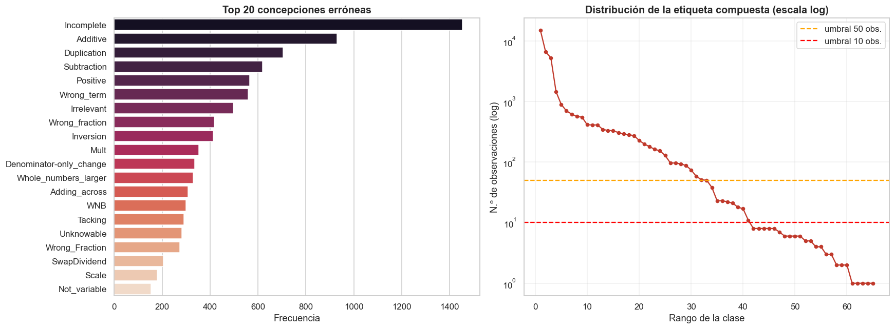
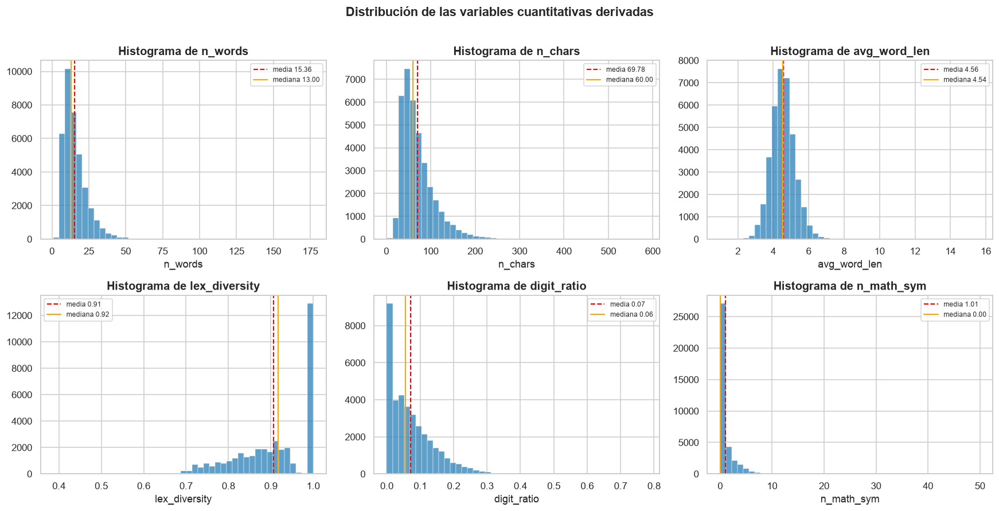
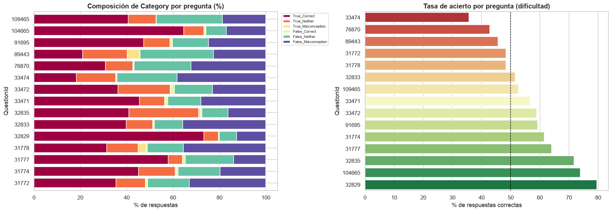
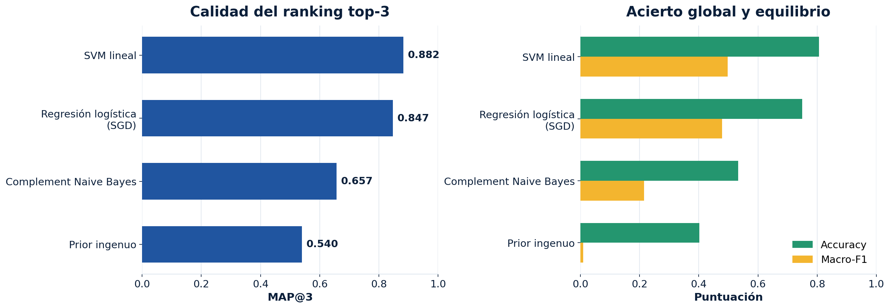
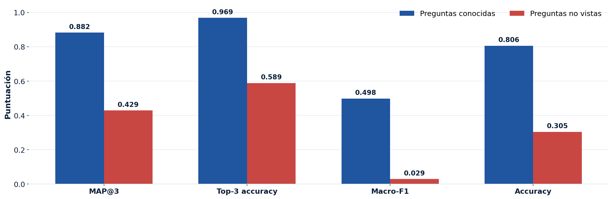
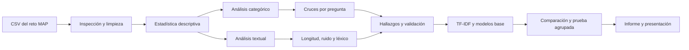

<div align="center">

# MAP — Charting Student Math Misunderstandings

### Análisis exploratorio y modelos base de explicaciones matemáticas mediante NLP

[](https://www.python.org/)
[](notebooks/02_modelos_base_MAP.ipynb)
[](#metodología)
[](#resultados-de-modelado-base)
[](LICENSE)

**Proyecto 2 · CC3084 Data Science · Sección 10**<br>
Universidad del Valle de Guatemala · 2026

[Informe](report/informe_analisis_exploratorio_MAP.pdf) ·
[Notebook EDA](notebooks/01_analisis_exploratorio.ipynb) ·
[Notebook de modelos](notebooks/02_modelos_base_MAP.ipynb) ·
[Presentación HTML](presentation/presentacion_MAP.html) ·
[PowerPoint](presentation/presentacion_MAP.pptx) ·
[Revisión bibliográfica](report/revision_bibliografica_algoritmos_MAP.pdf) ·
[Documento del repositorio](file/Presentacion_Repositorio_MAP.pdf)

</div>

---

## Contenido

- [Descripción](#descripción)
- [Situación problemática](#situación-problemática)
- [Objetivos](#objetivos)
- [Datos](#datos)
- [Resultados principales](#resultados-principales)
- [Resultados de modelado base](#resultados-de-modelado-base)
- [Metodología](#metodología)
- [Estructura del repositorio](#estructura-del-repositorio)
- [Instalación y ejecución](#instalación-y-ejecución)
- [Entregables](#entregables)
- [Limitaciones y próximos pasos](#limitaciones-y-próximos-pasos)
- [Equipo](#equipo)
- [Referencias](#referencias)

## Descripción

Este repositorio contiene el análisis exploratorio y una comparación reproducible de modelos base para el reto **MAP — Charting Student Math Misunderstandings**. El proyecto estudia explicaciones escritas por estudiantes para identificar patrones relacionados con:

1. la corrección de la opción seleccionada;
2. la calidad del razonamiento presentado; y
3. la concepción matemática errónea asociada, cuando corresponde.

La unidad de análisis es una explicación vinculada con una pregunta y una opción de respuesta. Por ello, el problema no consiste únicamente en detectar palabras frecuentes: requiere interpretar conjuntamente el **contexto de la pregunta**, la **opción elegida** y el **razonamiento textual**.

> [!IMPORTANT]
> El modelo base se diseñó para apoyar la revisión y priorización docente. Sus predicciones no deben utilizarse como diagnóstico automático definitivo del estudiante.

## Situación problemática

Una respuesta correcta no garantiza que el procedimiento utilizado también sea correcto. De forma similar, una opción incorrecta puede provenir de un error de cálculo aislado o de una concepción matemática más persistente.

Revisar manualmente miles de explicaciones abiertas requiere tiempo y conocimiento pedagógico. El Procesamiento del Lenguaje Natural ofrece herramientas para organizar las respuestas y proponer hipótesis sobre los patrones de razonamiento, siempre bajo supervisión humana.

### Pregunta científica

> ¿Qué patrones lingüísticos, estructurales y contextuales permiten distinguir la relación entre corrección de la respuesta, calidad del razonamiento y concepción matemática errónea?

## Objetivos

### Objetivo general

Caracterizar el conjunto MAP e implementar modelos base de NLP que permitan ordenar etiquetas compuestas, comparar su desempeño y medir su transferencia a preguntas no vistas.

### Objetivos específicos

- Describir las variables, tipos de datos, valores faltantes y distribución de las observaciones.
- Analizar el balance de `Category` y `Misconception`.
- Examinar longitud, ruido, marcadores léxicos y calidad de las explicaciones.
- Estudiar cruces entre pregunta, opción, categoría y concepción errónea.
- Detectar riesgos de fuga de información y proponer una estrategia de validación por pregunta.
- Plantear una ruta de modelado NLP reproducible y pedagógicamente responsable.
- Entrenar y comparar un prior ingenuo, Complement Naive Bayes, regresión logística y SVM lineal sobre una representación TF-IDF común.
- Seleccionar el mejor baseline mediante MAP@3 y auditar su generalización con preguntas completas fuera del entrenamiento.

## Datos

Los datos pertenecen a la competencia de Kaggle [MAP — Charting Student Math Misunderstandings](https://www.kaggle.com/competitions/map-charting-student-math-misunderstandings/overview).

### Archivos

| Archivo | Uso |
|---|---|
| `train.csv` | Datos etiquetados utilizados en el análisis exploratorio. |
| `test.csv` | Explicaciones sin etiqueta para la competencia. |
| `sample_submission.csv` | Formato requerido para una eventual entrega en Kaggle. |

### Variables principales

| Variable | Tipo | Descripción |
|---|---|---|
| `row_id` | Identificador | Identificador único de la observación. |
| `QuestionId` | Categórica | Pregunta matemática asociada. |
| `QuestionText` | Texto | Enunciado de la pregunta, cuando está disponible. |
| `MC_Answer` | Categórica/texto | Opción seleccionada por el estudiante. |
| `StudentExplanation` | Texto | Explicación abierta del razonamiento. |
| `Category` | Categórica objetivo | Relación entre corrección de la opción y del razonamiento. |
| `Misconception` | Categórica objetivo | Concepción errónea; no aplica a todas las categorías. |

### Perfil del conjunto analizado

| Observaciones | Preguntas | Opciones distintas | Concepciones erróneas | Etiquetas compuestas |
|:---:|:---:|:---:|:---:|:---:|
| **36,696** | **15** | **49** | **35** | **65** |

> [!NOTE]
> Los CSV no se versionan en Git. El notebook localiza automáticamente los archivos en `data/` o `data/raw/`, tanto si se inicia desde la raíz como desde `notebooks/`.

## Resultados principales

### 1. La etiqueta mayoritaria no representa todo el problema

`True_Correct` reúne **40.34%** de las observaciones. Aunque es la categoría más frecuente, usar únicamente *accuracy* favorecería las clases comunes y ocultaría el desempeño sobre concepciones raras.

<p align="center">
  
</p>

### 2. La ausencia de `Misconception` es principalmente estructural

Se encontraron **26,836 valores ausentes**, equivalentes a **73.1%** del conjunto. Esto no implica automáticamente mala calidad: en numerosas observaciones la concepción errónea no aplica porque la categoría describe un razonamiento correcto.

**Decisión:** no imputar esta variable con la moda. Debe tratarse como una salida condicional o jerárquica.

### 3. Existe una cola larga de concepciones erróneas

Pocas etiquetas concentran una gran cantidad de ejemplos y muchas concepciones aparecen con baja frecuencia. Esto exige métricas sensibles a clases minoritarias, ponderación cuidadosa y análisis de errores por etiqueta.

<p align="center">
  
</p>

### 4. Las explicaciones son breves y heterogéneas

- La mediana es de **13 palabras** y la media de **15.36**.
- No hay explicaciones vacías; existen 30 respuestas mínimas de una o dos palabras y valores extremos de longitud.
- La ortografía, puntuación y uso de mayúsculas son variables.
- Números, negaciones, operadores y expresiones matemáticas aportan señal y no deben eliminarse indiscriminadamente.
- Parte del ruido del benchmark fue introducida sintéticamente, por lo que no todo error ortográfico representa conducta natural del estudiante.

<p align="center">
  
</p>

### 5. La pregunta condiciona fuertemente el lenguaje

La distribución de categorías y concepciones cambia entre preguntas. Un *split* aleatorio puede colocar vocabulario casi idéntico de una misma pregunta en entrenamiento y validación, produciendo una estimación optimista de generalización.

<p align="center">
  
</p>

**Recomendación:** reportar por separado una partición estratificada —preguntas conocidas— y `GroupKFold` o *leave-one-question-out* —transferencia a preguntas nuevas—. Ninguna debe interpretarse aisladamente, porque 32 de las 35 concepciones aparecen en una sola pregunta.

### Síntesis de decisiones

| Hallazgo | Implicación |
|---|---|
| Clases desbalanceadas | Reportar MAP@3 y macro-F1, además de métricas globales. |
| `Misconception` es condicional | Modelar primero `Category` y luego la concepción, si aplica. |
| Longitudes altamente correlacionadas | Usarlas como diagnóstico auxiliar, no como evidencia independiente. |
| Lenguaje dependiente de la pregunta | Validar separando preguntas completas. |
| Texto informal con notación matemática | Preservar números, operadores, negaciones y unidades. |
| Etiquetas raras | Revisar desempeño y errores por clase. |

## Resultados de modelado base

Se concatenaron `QuestionText`, `MC_Answer` y `StudentExplanation`. Después de retirar **736 duplicados exactos**, se modelaron **35,960 respuestas** mediante una unión de TF-IDF de palabras —uno y dos términos— y caracteres —tres a cinco—, con **41,763 características**. Todos los clasificadores usaron la misma partición estratificada 80/20 y semilla 42.

| Modelo | MAP@3 | Top-3 accuracy | Macro-F1 | Accuracy |
|---|---:|---:|---:|---:|
| **SVM lineal** | **0.882** | **0.969** | **0.498** | **0.806** |
| Regresión logística —SGD— | 0.847 | 0.962 | 0.479 | 0.750 |
| Complement Naive Bayes | 0.657 | 0.812 | 0.215 | 0.533 |
| Prior ingenuo | 0.540 | 0.727 | 0.010 | 0.403 |

<p align="center">
  
</p>

**Selección:** SVM lineal es el mejor baseline porque lidera MAP@3, macro-F1 y accuracy bajo condiciones controladas. No se considera una solución final: en una segunda prueba con tres preguntas completas fuera del entrenamiento, MAP@3 cae a **0.429**, macro-F1 a **0.029** y accuracy a **0.305**. Además, **16.1%** de esas respuestas pertenece a diez etiquetas no observadas durante el ajuste.

<p align="center">
  
</p>

Los resultados resumidos se encuentran en [`report/model_results/`](report/model_results/). El modelo serializado y las predicciones fila por fila se generan localmente, pero no se versionan porque son artefactos reproducibles y más voluminosos.

## Metodología



El notebook desarrolla las siguientes fases:

1. carga y validación del esquema;
2. revisión de duplicados y valores faltantes;
3. estadísticas descriptivas y tablas de frecuencia;
4. análisis de `Category` y `Misconception`;
5. creación de variables de longitud y calidad textual;
6. correlaciones y análisis de valores extremos;
7. cruces entre pregunta, respuesta y etiquetas;
8. extracción exploratoria de marcadores léxicos mediante TF-IDF;
9. síntesis de hallazgos y recomendaciones de modelado.

### Ruta de modelado

```text
TF-IDF de palabras y caracteres
             ↓
Prior + Complement NB + regresión logística + SVM
             ↓
SVM lineal seleccionado como baseline reproducible
             ↓
Prueba agrupada por QuestionId
             ↓
Siguiente fase: DeBERTa / MathBERT → calibración → revisión docente
```

## Estructura del repositorio

```text
Proyecto-2_Grupo-1_DS_Sec-10/
├── data/                         # Datos locales; ignorados por Git
│   ├── train.csv
│   ├── test.csv
│   └── sample_submission.csv
├── file/
│   ├── Presentacion_Repositorio_MAP.docx
│   └── Presentacion_Repositorio_MAP.pdf
├── instructions/
│   └── Proyecto 2. Análisis Exploratorio. 2026.pdf
├── notebooks/
│   ├── 01_analisis_exploratorio.ipynb
│   ├── 02_modelos_base_MAP.ipynb
│   ├── entrenar_modelos_base_MAP.py
│   ├── generar_graficas_presentacion_MAP.py
│   └── exportar_figuras.py
├── presentation/
│   ├── presentacion_MAP.html
│   ├── presentacion_MAP.pptx
│   ├── presentacion_MAP.pdf
│   └── generar_presentacion.py
├── report/
│   ├── assets/                   # Figuras extraídas del notebook
│   ├── model_results/            # Métricas, predicciones y resultados por clase
│   ├── informe_analisis_exploratorio_MAP.tex
│   ├── informe_analisis_exploratorio_MAP.pdf
│   ├── revision_bibliografica_algoritmos_MAP.tex
│   └── revision_bibliografica_algoritmos_MAP.pdf
├── .gitignore
├── LICENSE
├── requirements.txt
├── validate_project.py
└── README.md
```

## Instalación y ejecución

### 1. Clonar el repositorio

```bash
git clone https://github.com/DanielBarillasM/Proyecto-2_Grupo-1_DS_Sec-10.git
cd Proyecto-2_Grupo-1_DS_Sec-10
```

### 2. Crear un entorno virtual

Windows PowerShell:

```powershell
python -m venv .venv
.\.venv\Scripts\Activate.ps1
```

Linux o macOS:

```bash
python3 -m venv .venv
source .venv/bin/activate
```

### 3. Instalar dependencias

```bash
python -m pip install --upgrade pip
pip install -r requirements.txt
```

### 4. Descargar los datos

Después de configurar las credenciales de la API de Kaggle y aceptar las reglas de la competencia:

```bash
mkdir -p data
kaggle competitions download \
  -c map-charting-student-math-misunderstandings \
  -p data
python -m zipfile -e \
  data/map-charting-student-math-misunderstandings.zip \
  data
```

En PowerShell puede crear la carpeta con:

```powershell
New-Item -ItemType Directory -Force data
```

Al terminar, compruebe esta estructura:

```text
data/train.csv
data/test.csv
data/sample_submission.csv
```

> [!NOTE]
> También se admite la estructura `data/raw/`; la celda de carga informa las rutas revisadas si no encuentra los archivos.

### 5. Abrir los notebooks

```bash
jupyter lab notebooks/01_analisis_exploratorio.ipynb
jupyter lab notebooks/02_modelos_base_MAP.ipynb
```

Ejecute las celdas en orden únicamente si necesita reproducir el análisis. Ambos notebooks versionados contienen salidas verificadas; el de modelos se ejecutó de principio a fin sin errores. Para actualizar los activos del EDA:

```bash
python notebooks/exportar_figuras.py
```

Para reproducir únicamente los modelos base desde la terminal:

```bash
python notebooks/entrenar_modelos_base_MAP.py
```

Este comando vuelve a entrenar los cuatro modelos, por lo que puede tardar varios minutos. Escribe métricas y predicciones en `report/model_results/`, figuras en `report/assets/modelos/` y el mejor artefacto en `models/`. El modelo, las predicciones completas y el guion de exposición son archivos locales ignorados por Git.

### 6. Compilar el informe LaTeX — opcional

Desde la carpeta `report/`, con una distribución de LaTeX instalada:

```bash
cd report
latexmk -pdf -interaction=nonstopmode -halt-on-error informe_analisis_exploratorio_MAP.tex
latexmk -pdf -interaction=nonstopmode -halt-on-error revision_bibliografica_algoritmos_MAP.tex
```

Para limpiar archivos auxiliares sin eliminar el PDF:

```bash
latexmk -c informe_analisis_exploratorio_MAP.tex
```

### 7. Abrir o regenerar la presentación

Abra [`presentation/presentacion_MAP.html`](presentation/presentacion_MAP.html) en un navegador moderno. Sus imágenes se cargan desde `report/assets/` mediante rutas relativas.

Controles disponibles:

- `←` / `→`, `Page Up` / `Page Down` o espacio: navegar.
- `Home` / `End`: ir al inicio o al final.
- `O`: activar la vista general.
- `F`: activar pantalla completa.
- Impresión del navegador: exportar las diapositivas a PDF.

La versión editable en PowerPoint está en [`presentation/presentacion_MAP.pptx`](presentation/presentacion_MAP.pptx). Puede regenerarse a partir de los mismos activos con:

```bash
python presentation/generar_presentacion.py
```

Para comprobar de una vez la ejecución almacenada, las rutas de imágenes y los formatos entregables:

```bash
python validate_project.py
```

## Entregables

| Entregable | Formato | Enlace |
|---|:---:|---|
| Notebook de análisis exploratorio | `.ipynb` | [Abrir notebook](notebooks/01_analisis_exploratorio.ipynb) |
| Notebook ejecutado de modelos base | `.ipynb` | [Abrir notebook](notebooks/02_modelos_base_MAP.ipynb) |
| Métricas comparativas | `.csv` | [Abrir resultados](report/model_results/comparacion_modelos.csv) |
| Informe científico completo | `.pdf` | [Abrir informe](report/informe_analisis_exploratorio_MAP.pdf) |
| Fuente editable del informe | `.tex` | [Abrir fuente](report/informe_analisis_exploratorio_MAP.tex) |
| Presentación interactiva | `.html` | [Abrir presentación](presentation/presentacion_MAP.html) |
| Presentación PowerPoint | `.pptx` | [Descargar PowerPoint](presentation/presentacion_MAP.pptx) |
| Copia PDF de la presentación | `.pdf` | [Abrir presentación](presentation/presentacion_MAP.pdf) |
| Revisión bibliográfica | `.pdf` | [Abrir revisión](report/revision_bibliografica_algoritmos_MAP.pdf) |
| Fuente de la revisión bibliográfica | `.tex` | [Abrir fuente](report/revision_bibliografica_algoritmos_MAP.tex) |
| Presentación documental del repositorio | `.pdf` | [Abrir PDF](file/Presentacion_Repositorio_MAP.pdf) |
| Documento editable del repositorio | `.docx` | [Descargar DOCX](file/Presentacion_Repositorio_MAP.docx) |
| Instrucciones académicas | `.pdf` | [Abrir instrucciones](instructions/Proyecto%202.%20Análisis%20Exploratorio.%202026.pdf) |

## Limitaciones y próximos pasos

- El conjunto no contiene variables demográficas, por lo que no permite evaluar equidad entre subgrupos estudiantiles.
- El benchmark completo combina respuestas originales y sintéticas; esto debe considerarse al interpretar el ruido textual.
- Las concepciones raras disponen de pocos ejemplos.
- La asociación léxica no demuestra causalidad pedagógica.
- La evaluación debe evitar fuga de información entre preguntas; `QuestionId` se usa para agrupar, no como predictor.
- La prueba agrupada confirma una transferencia limitada: MAP@3 0.429 y macro-F1 0.029.
- Diez etiquetas no aparecen en el entrenamiento de la partición agrupada y afectan 16.1% de sus respuestas de validación.
- Deben hacerse `commit` y `push` de los entregables finales con autoría clara para cada integrante.

### Siguiente experimento recomendado

1. mantener SVM lineal como baseline reproducible;
2. comparar clasificación plana y jerárquica;
3. entrenar DeBERTa o MathBERT con pregunta, opción y explicación;
4. conservar la misma prueba agrupada por `QuestionId` y reportar MAP@3, macro-F1 y resultados por pregunta;
5. calibrar los puntajes top-3 y definir un criterio de abstención;
6. revisar cualitativamente errores, clases raras y preguntas no vistas.

## Equipo

| Integrante | Rol general |
|---|---|
| **Jorge Gabriel Palacios Sales** | Integrante del grupo. |
| **Pablo Daniel Barillas Moreno** | Integrante del grupo. |
| **Roberto Emiliano Otoniel Camposeco Torres** | Integrante del grupo. |
| **Abby Sofia Donis Agreda** | Integrante del grupo. |

> La evaluación del curso considera las contribuciones individuales reflejadas en el historial de Git.

## Referencias

- Devlin, J., Chang, M.-W., Lee, K., & Toutanova, K. (2019). BERT: Pre-training of deep bidirectional transformers for language understanding. *NAACL-HLT 2019*, 4171–4186. https://doi.org/10.18653/v1/N19-1423
- He, P., Liu, X., Gao, J., & Chen, W. (2021). DeBERTa: Decoding-enhanced BERT with disentangled attention. *International Conference on Learning Representations*.
- Kassis, T., Agarwal, V., He, Y., Patel, D., & Brueckner, A. M. (2026). *Scientific agent skills: A library of procedural knowledge for research agents* [Preprint]. arXiv. https://doi.org/10.48550/arXiv.2609.00065
- King, J., Smith, K., Burleigh, L., Crossley, S., Demkin, M., & Reade, W. (2025). *MAP — Charting student math misunderstandings*. Kaggle. https://www.kaggle.com/competitions/map-charting-student-math-misunderstandings
- Pedregosa, F., Varoquaux, G., Gramfort, A., Michel, V., Thirion, B., Grisel, O., et al. (2011). Scikit-learn: Machine learning in Python. *Journal of Machine Learning Research, 12*, 2825–2830.
- Rittle-Johnson, B., Adler, R., Durkin, K., Burleigh, L., King, J., & Crossley, S. (2025). Detecting math misconceptions: An AI benchmark dataset. *AIME-Con Works in Progress*, 20–24. https://aclanthology.org/2025.aimecon-wip.3/
- Salton, G., & Buckley, C. (1988). Term-weighting approaches in automatic text retrieval. *Information Processing & Management, 24*(5), 513–523. https://doi.org/10.1016/0306-4573(88)90021-0
- Shen, J. T., Yamashita, M., Prihar, E., Heffernan, N., Wu, X., Graff, B., & Lee, D. (2021). *MathBERT: A pre-trained language model for general NLP tasks in mathematics education* [Preprint]. arXiv. https://doi.org/10.48550/arXiv.2106.07340

---

<div align="center">

**Comprender el error es el primer paso para enseñar mejor.**

Si este repositorio le resulta útil, puede citar la competencia y el benchmark incluidos en la sección de referencias.

</div>
