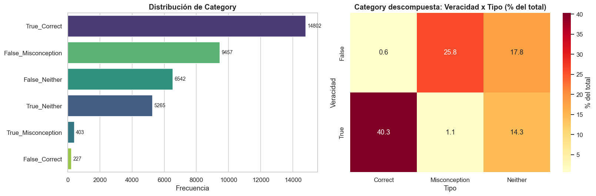
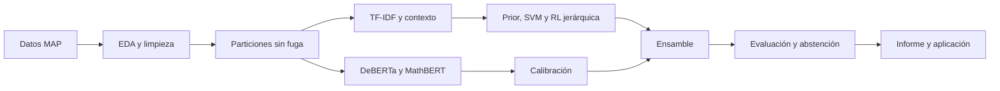
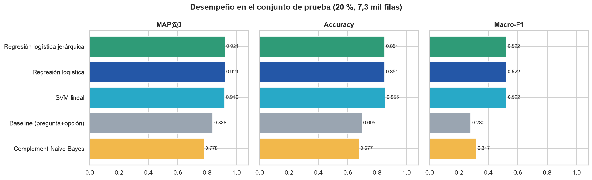
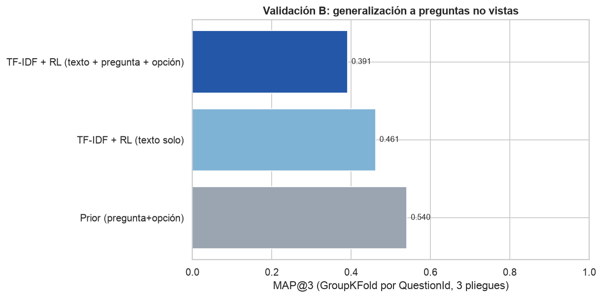
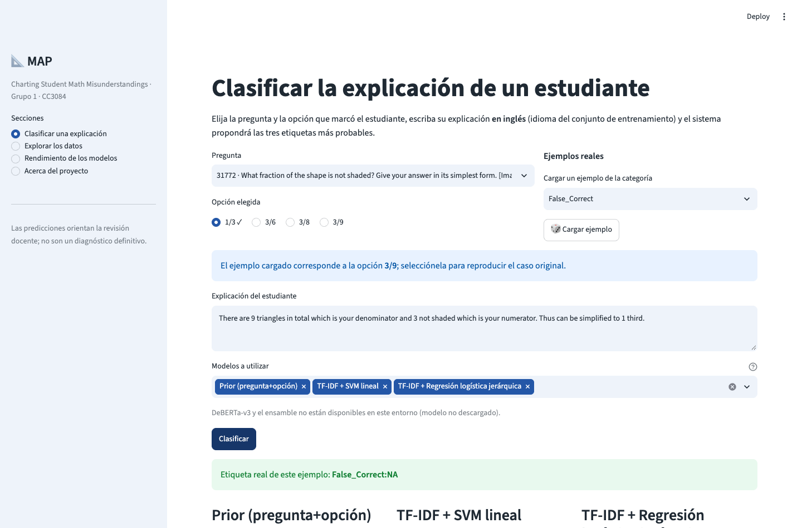

<div align="center">

# MAP - Charting Student Math Misunderstandings

### Clasificación de concepciones erróneas en explicaciones matemáticas mediante NLP

[](https://www.python.org/)
[](#metodología)
[](#modelos-y-resultados)
[](#resultados-finales)
[](https://proyecto-2grupo-1dssec-10-yakgdjmx6l95w8ozmt5yep.streamlit.app/)
[](LICENSE)

**Proyecto 2 · CC3084 Data Science · Sección 10**<br>
Universidad del Valle de Guatemala · Semestre II de 2026

[Informe final](report/informe_resultados_MAP.pdf) ·
[Aplicación](https://proyecto-2grupo-1dssec-10-yakgdjmx6l95w8ozmt5yep.streamlit.app/) ·
[Presentación](presentation/presentacion_MAP.pdf) ·
[Revisión bibliográfica](report/revision_bibliografica_algoritmos_MAP.pdf) ·
[Notebook EDA](notebooks/01_analisis_exploratorio.ipynb)

</div>

---

## Contenido

- [Descripción](#descripción)
- [Problema y objetivos](#problema-y-objetivos)
- [Conjunto de datos](#conjunto-de-datos)
- [Metodología](#metodología)
- [Modelos y resultados](#modelos-y-resultados)
- [Aplicación Streamlit](#aplicación-streamlit)
- [Estructura del repositorio](#estructura-del-repositorio)
- [Instalación y reproducción](#instalación-y-reproducción)
- [Entregables del proyecto](#entregables-del-proyecto)
- [Lista de verificación para Canvas](#lista-de-verificación-para-canvas)
- [Limitaciones](#limitaciones)
- [Equipo](#equipo)

## Descripción

Este repositorio contiene el análisis exploratorio, la revisión bibliográfica, el entrenamiento de modelos, la evaluación y la aplicación interactiva del reto de Kaggle [MAP - Charting Student Math Misunderstandings](https://www.kaggle.com/competitions/map-charting-student-math-misunderstandings/overview).

El sistema analiza tres componentes de cada respuesta:

1. la pregunta matemática;
2. la opción seleccionada por el estudiante; y
3. la explicación escrita de su razonamiento.

La salida es un ranking de hasta tres etiquetas `Category:Misconception`. La métrica principal es **MAP@3**, que premia que la etiqueta correcta aparezca en las primeras posiciones.

> [!IMPORTANT]
> El sistema sirve para apoyar y priorizar la revisión docente. Sus predicciones no sustituyen el juicio pedagógico ni constituyen un diagnóstico definitivo del estudiante.

## Problema y objetivos

### Situación problemática

Una respuesta correcta no garantiza un razonamiento correcto: un estudiante puede acertar por casualidad o aplicando una regla equivocada. De igual forma, una respuesta incorrecta puede deberse a un error aislado o a una concepción matemática errónea persistente.

Revisar manualmente miles de explicaciones requiere tiempo y conocimiento especializado. El proyecto estudia si el procesamiento de lenguaje natural puede proponer hipótesis útiles y ordenadas sobre esos patrones de razonamiento.

### Pregunta de investigación

> ¿Qué combinación de representación textual, contexto de la pregunta y modelos de clasificación permite ordenar correctamente las concepciones erróneas más probables, y cuánto se conserva ese desempeño ante preguntas no vistas?

### Objetivo general

Construir, ajustar y comparar modelos supervisados que clasifiquen explicaciones matemáticas en la etiqueta compuesta `Category:Misconception`, fundamentando el preprocesamiento, la validación y la selección final en el análisis exploratorio y en la literatura.

### Objetivos específicos

- Caracterizar la estructura, calidad y desbalance de los datos.
- Investigar algoritmos usados en calificación automática y detección de concepciones erróneas.
- Entrenar y comparar un prior contextual, modelos TF-IDF, Transformers y un ensamble calibrado.
- Evaluar MAP@3, exactitud, top-3 accuracy, macro-F1, F1 ponderado, calibración y costo computacional.
- Analizar el efecto de la pregunta y la opción mediante ablación y validación con preguntas no vistas.
- Seleccionar un modelo final y definir un umbral de abstención para derivar casos inciertos al docente.
- Construir una aplicación que permita clasificar explicaciones, explorar datos y comparar modelos.

## Conjunto de datos

Los datos provienen de la competencia de Kaggle y están sujetos a sus reglas de uso. El conjunto de entrenamiento local contiene:

| Característica | Cantidad |
|---|---:|
| Observaciones | 36,696 |
| Variables originales | 7 |
| Preguntas | 15 |
| Opciones distintas | 49 |
| Categorías | 6 |
| Concepciones erróneas | 35 |
| Etiquetas compuestas | 65 |
| Explicaciones únicas | 35,726 |

### Variables

| Variable | Tipo | Uso |
|---|---|---|
| `row_id` | Identificador | Control de filas; no se usa como predictor. |
| `QuestionId` | Categórica | Contexto y agrupamiento. |
| `QuestionText` | Texto | Enunciado de la pregunta. |
| `MC_Answer` | Texto/categórica | Opción seleccionada. |
| `StudentExplanation` | Texto libre | Predictora textual principal. |
| `Category` | Categórica | Veracidad y calidad del razonamiento. |
| `Misconception` | Categórica | Concepción errónea cuando aplica. |

### Hallazgos que condicionan el modelado

- `True_Correct` concentra aproximadamente 40.3 % de las observaciones.
- Los nulos de `Misconception` son estructurales; se representan con `NA`.
- Las explicaciones tienen una mediana cercana a 13 palabras.
- El 78.3 % contiene dígitos, por lo que números y operadores no se eliminan.
- 32 de las 35 concepciones erróneas aparecen en una sola pregunta.
- La pregunta y la opción aportan una señal fuerte, pero también pueden funcionar como atajos que reducen la transferencia.
- La distribución de etiquetas tiene una cola larga: las clases raras explican buena parte del macro-F1 moderado.

<p align="center">
  
</p>

## Metodología



### Preprocesamiento

- Conversión de opciones LaTeX a texto plano.
- Minúsculas y unificación de espacios.
- Conservación de números, operadores, unidades y negaciones.
- TF-IDF de palabras con unigramas y bigramas.
- TF-IDF de caracteres de 2 a 5 caracteres para tolerar errores ortográficos.
- Codificación one-hot de `QuestionId` y del par pregunta-opción.
- Entrada Transformer con el formato `Question + Answer + Explanation`, truncada a 160 tokens.
- Agrupamiento de textos repetidos para prevenir fuga entre entrenamiento y evaluación.

### Protocolo de validación

- **Prueba principal:** 20 % del conjunto mediante `StratifiedGroupKFold`, manteniendo duplicados en un solo lado.
- **Validación interna:** ajuste de hiperparámetros dentro del conjunto de entrenamiento.
- **Validación por preguntas nuevas:** `GroupKFold` de 3 pliegues usando `QuestionId` como grupo.
- **Semilla:** 42 para los procedimientos reproducibles.

### Métricas

- MAP@3, métrica oficial del reto.
- Accuracy y top-3 accuracy.
- Macro-F1 y F1 ponderado.
- Expected Calibration Error (ECE).
- Cobertura y exactitud bajo abstención.
- Tiempos de entrenamiento y predicción.

## Modelos y resultados

### Modelos evaluados

| Familia | Modelo | Función |
|---|---|---|
| Referencia | Prior por pregunta y opción | Mide cuánto se logra sin leer la explicación. |
| Lineal | TF-IDF + SVM lineal | Clasificador rápido para matrices dispersas. |
| Lineal jerárquico | TF-IDF + regresión logística | Entrega probabilidades y restringe etiquetas incompatibles. |
| Transformer | DeBERTa-v3-base | Representación contextual general. |
| Transformer de dominio | MathBERT | Representación preentrenada con texto matemático. |
| Ensamble | MathBERT + regresión jerárquica | Combina evidencia contextual y léxica calibrada. |

### Resultados finales

| Modelo | MAP@3 | Accuracy | Top-3 | Macro-F1 | Entrenamiento |
|---|---:|---:|---:|---:|---:|
| Prior por pregunta y opción | 0.838 | 0.695 | 0.989 | 0.280 | 0.01 s |
| TF-IDF + SVM lineal | 0.919 | **0.855** | 0.986 | 0.522 | 9.74 s |
| TF-IDF + regresión logística jerárquica | 0.921 | 0.851 | **0.995** | 0.522 | 56.90 s |
| DeBERTa-v3 | 0.914 | 0.847 | 0.986 | 0.407 | 821.58 s |
| MathBERT | 0.926 | 0.862 | 0.993 | 0.500 | 455.08 s |
| **Ensamble calibrado** | **0.930** | **0.868** | **0.995** | **0.531** | 511.98 s |

<p align="center">
  
</p>

### Selección del modelo

El modelo seleccionado es el **ensamble calibrado de MathBERT y regresión logística jerárquica**:

- temperatura del Transformer: `T = 1.10`;
- peso de MathBERT: `α = 0.65`;
- MAP@3 de prueba: `0.930`;
- macro-F1: `0.531`;
- ECE: aproximadamente `0.023`.

La regresión logística jerárquica se conserva como alternativa ligera para despliegues sin GPU y la SVM como alternativa de reentrenamiento rápido.

### Abstención y supervisión humana

Con un umbral de confianza de `0.87`:

- cobertura: 71.3 % de los casos;
- exactitud entre casos aceptados: 94.7 %;
- los casos restantes se derivan a revisión docente.

### Preguntas no vistas

| Modelo | MAP@3 en preguntas no vistas |
|---|---:|
| Prior por pregunta y opción | 0.540 |
| Regresión logística con texto solamente | 0.461 |
| Regresión logística con texto, pregunta y opción | 0.391 |
| MathBERT | 0.324 |
| DeBERTa-v3 | 0.298 |

El contexto mejora considerablemente el desempeño en preguntas conocidas, pero no transfiere bien a preguntas nuevas. Por ello, los resultados deben interpretarse como válidos para el banco de preguntas estudiado.

<p align="center">
  
</p>

## Aplicación Streamlit

La aplicación está implementada en [`app/app.py`](app/app.py) y contiene cuatro secciones:

1. **Clasificar una explicación:** recibe pregunta, opción y explicación; devuelve tres etiquetas ordenadas.
2. **Explorar los datos:** filtros, distribuciones, variables derivadas y composición por pregunta.
3. **Rendimiento de los modelos:** métricas, tiempos, generalización, calibración, abstención e hiperparámetros.
4. **Acerca del proyecto:** contexto, modelos, limitaciones y uso responsable.

Funciones requeridas por la guía:

- selección de uno o varios modelos;
- comparación visual de predicciones;
- gráficas interactivas de rendimiento;
- interruptor para mostrar u ocultar el rendimiento;
- preprocesamiento automático e inadvertido para el usuario;
- interfaz con tema claro, azul institucional y colores semánticos.

**Aplicación publicada:**<br>
<https://proyecto-2grupo-1dssec-10-yakgdjmx6l95w8ozmt5yep.streamlit.app/>

> [!NOTE]
> GitHub no almacena los pesos ajustados de DeBERTa y MathBERT por su tamaño. La versión web clasifica con los modelos TF-IDF versionados y presenta las métricas de todos los modelos. Para habilitar Transformers en inferencia se deben descargar sus pesos o configurar los repositorios correspondientes en los secretos de Streamlit.

<p align="center">
  
</p>

## Estructura del repositorio

```text
Proyecto-2_Grupo-1_DS_Sec-10/
├── app/
│   ├── app.py
│   ├── requirements.txt
│   └── datos/
├── data/                         # Datos de Kaggle, no redistribuidos en GitHub
├── kaggle/                       # Kernels para DeBERTa y MathBERT
├── models/                       # Modelos TF-IDF y configuración del ensamble
├── notebooks/
│   ├── 01_analisis_exploratorio.ipynb
│   ├── 02_modelado.py
│   ├── 03_transformer.py
│   └── 04_ensamble.py
├── presentation/                 # HTML, PDF, PPTX y guion
├── report/
│   ├── assets/
│   ├── informe_resultados_MAP.docx
│   ├── informe_resultados_MAP.pdf
│   └── revision_bibliografica_algoritmos_MAP.pdf
├── results/                      # Métricas, particiones y predicciones
├── map_modelos.py                # Preprocesamiento y clases compartidas
├── requirements.txt
└── README.md
```

## Instalación y reproducción

### 1. Clonar el repositorio

```bash
git clone https://github.com/DanielBarillasM/Proyecto-2_Grupo-1_DS_Sec-10.git
cd Proyecto-2_Grupo-1_DS_Sec-10
```

### 2. Crear un entorno para análisis y modelos lineales

```bash
python -m venv .venv
```

Windows PowerShell:

```powershell
.\.venv\Scripts\Activate.ps1
python -m pip install --upgrade pip
pip install -r requirements.txt
```

Linux o macOS:

```bash
source .venv/bin/activate
python -m pip install --upgrade pip
pip install -r requirements.txt
```

### 3. Descargar los datos

Después de aceptar las reglas de la competencia y configurar la API de Kaggle:

```bash
kaggle competitions download -c map-charting-student-math-misunderstandings -p data
python -m zipfile -e data/map-charting-student-math-misunderstandings.zip data
```

La estructura esperada es:

```text
data/train.csv
data/test.csv
data/sample_submission.csv
```

### 4. Reproducir los modelos lineales

```bash
python notebooks/02_modelado.py
```

Este script genera los modelos de `models/`, las métricas de `results/` y las figuras de modelado.

### 5. Entrenar Transformers

El entrenamiento completo se recomienda en Kaggle con GPU. Los kernels reproducibles se encuentran en `kaggle/`.

Para una ejecución manual se requiere un entorno separado con PyTorch y Hugging Face Transformers:

```bash
pip install torch transformers accelerate
python notebooks/03_transformer.py --modelo microsoft/deberta-v3-base --prefijo deberta
python notebooks/03_transformer.py --modelo tbs17/MathBERT --prefijo mathbert
```

### 6. Calibrar y construir el ensamble

```bash
python notebooks/04_ensamble.py
```

### 7. Ejecutar la aplicación

Se recomienda usar un entorno exclusivo para la aplicación:

```bash
python -m venv .venv-app
# Active el entorno según su sistema operativo
pip install -r app/requirements.txt
streamlit run app/app.py
```

## Entregables del proyecto

| Entregable | Ruta o enlace |
|---|---|
| Informe final en PDF | [`report/informe_resultados_MAP.pdf`](report/informe_resultados_MAP.pdf) |
| Informe editable | [`report/informe_resultados_MAP.docx`](report/informe_resultados_MAP.docx) |
| Revisión bibliográfica | [`report/revision_bibliografica_algoritmos_MAP.pdf`](report/revision_bibliografica_algoritmos_MAP.pdf) |
| Código de modelado lineal | [`notebooks/02_modelado.py`](notebooks/02_modelado.py) |
| Código de Transformers | [`notebooks/03_transformer.py`](notebooks/03_transformer.py) |
| Código del ensamble | [`notebooks/04_ensamble.py`](notebooks/04_ensamble.py) |
| Aplicación | [`app/app.py`](app/app.py) |
| Resultados reproducibles | [`results/`](results/) |
| Presentación PDF | [`presentation/presentacion_MAP.pdf`](presentation/presentacion_MAP.pdf) |
| Presentación editable | [`presentation/presentacion_MAP.pptx`](presentation/presentacion_MAP.pptx) |
| Repositorio | <https://github.com/DanielBarillasM/Proyecto-2_Grupo-1_DS_Sec-10> |
| Aplicación web | <https://proyecto-2grupo-1dssec-10-yakgdjmx6l95w8ozmt5yep.streamlit.app/> |

## Limitaciones

- Las concepciones raras disponen de muy pocos ejemplos.
- El desempeño cae al evaluar preguntas completamente nuevas.
- `QuestionId` mejora las preguntas conocidas, pero puede actuar como atajo contextual.
- Los pesos Transformer no se versionan en GitHub por su tamaño.
- El conjunto no incluye variables demográficas para auditar equidad entre subgrupos.
- La asociación estadística entre texto y etiqueta no demuestra causalidad pedagógica.
- Las predicciones deben mantenerse bajo supervisión humana.

## Equipo

| Integrante | Participación general |
|---|---|
| **Jorge Gabriel Palacios Sales** | Integrante del grupo. |
| **Pablo Daniel Barillas Moreno** | Integrante del grupo. |
| **Roberto Emiliano Otoniel Camposeco Torres** | Integrante del grupo. |
| **Abby Sofia Donis Agreda** | Integrante del grupo. |

La evaluación individual del curso se basa en las contribuciones registradas en el trabajo grupal y en el historial de GitHub.

## Referencias principales

- Kaggle. (2025). *MAP - Charting student math misunderstandings* [Competencia de ciencia de datos]. <https://www.kaggle.com/competitions/map-charting-student-math-misunderstandings>
- He, P., Liu, X., Gao, J., & Chen, W. (2021). DeBERTa: Decoding-enhanced BERT with disentangled attention. *International Conference on Learning Representations*.
- Pedregosa, F., et al. (2011). Scikit-learn: Machine learning in Python. *Journal of Machine Learning Research, 12*, 2825-2830.
- Shen, J. T., et al. (2021). MathBERT: A pre-trained language model for general NLP tasks in mathematics education. *arXiv*. <https://doi.org/10.48550/arXiv.2106.07340>
- Salton, G., & Buckley, C. (1988). Term-weighting approaches in automatic text retrieval. *Information Processing & Management, 24*(5), 513-523. <https://doi.org/10.1016/0306-4573(88)90021-0>

---

<div align="center">

**Grupo 1 · Data Science · Sección 10 · UVG**

</div>
